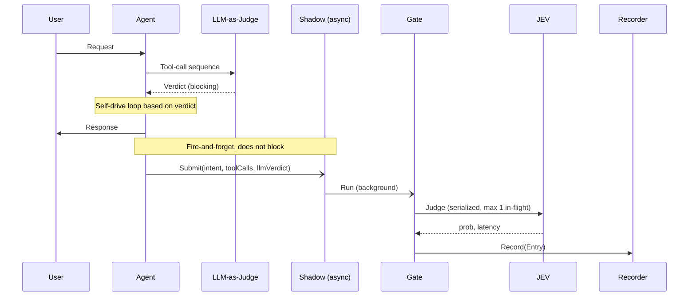

[](https://github.com/ironsweet/jev-shadow/actions/workflows/ci.yml)
[](https://pkg.go.dev/github.com/ironsweet/jev-shadow)

# jev-shadow

A Go library for shadow-testing JEV-like decision models against an existing 
LLM-as-judge in my personal agent pipelines.

> "JEV" refers to a class of small, locally-runnable decision models (e.g., 
> Jev-Style-2B) that answer structured judgment predicates (noul / choice
> / score) much faster than generic LLMs.

## Why

My personal agent uses cheap LLMs to verify whether a tool-call sequence
satisfies user intent. A locally deployed JEV-like model can judge the same 
predicate in ~2s on a consumer GPU (RTX 2060). This library runs JEV-like
models in **shadow mode**: it samples the same traffic as my existing judge,
records both verdicts, and lets me decide if JEV-like models are ready to 
replace it.

See [Design Notes](#design-notes) for the trade-offs behind this design.

## How it works



## Quick Start

```go
package main

import (
	"time"

	jevshadow "github.com/ironsweet/jev-shadow"
)

func main() {
	s := jevshadow.NewShadow(
		jevshadow.NewClient("http://localhost:8080", 5*time.Second),
		jevshadow.NewFileRecorder(jevshadow.FileRecorderOptions{
			Location: "/tmp/records.jsonl",
		}),
		jevshadow.NewGate(jevshadow.GateOptions{MaxInFlight: 5}),
	)

	// Inside agent hook
	userIntent := "User's raw request"
	toolCalls := "Combined tool calls from LLM"
	llmVerdict := "LLM's verdict on whether the tool calls satisfy the user intent"
	s.Submit(userIntent, toolCalls, llmVerdict)

	// After running a while, you can ask your agent to analyze the recorded data
}
```

## Design Notes

It's hard to hand-craft a good Gate implementation which enforces both
sequential ordering and max in-flight constraints. I was thinking about
ring-buffer, worker pool, complex syncing, but turned out to be two channels
and two selects - enough to express both serialization and bounded concurrency,
with no mutex, no state machine, no lifecycle.

Panic recovery and not accepting the caller's context are key to keeping the
library boundary clean - the shadow layer never blocks or aborts the main agent
flow.

Only successful verdicts are recorded. Reliability isn't a concern yet - 
stage 3 will add failure logging when the fallback path needs to be designed.
My plan for migration consists of:
1. feasibility study through POC
2. shadow running and threshold tuning with successful records
3. enable JEV with old LLM as fallback
4. fully switch to JEV and remove LLM-as-judge

## After the dry-run

`records.jsonl` contains one Entry per successful judgment:

{"timestamp":"...","user_intent":"...","tool_calls":"...","existing_verdict":"yes","jev_probability":0.88,"latency_ms":2069}

To compare JEV against your LLM-as-judge, compute the agreement rate at your
chosen threshold:

```bash
jq -r 'if ((.jev_probability >= 0.7 and .existing_verdict == "yes")
         or (.jev_probability < 0.7 and .existing_verdict == "no"))
       then "agree" else "disagree" end' records.jsonl | sort | uniq -c
```

A high agreement rate + low `latency_ms` P99 + high coverage (entries / submits)
means JEV is a viable replacement.

## Status

Personal-use library. Validated end-to-end against `Jev-Style-2B-Decision-v3`
on an RTX 2060 (6GB). Shadow dry-run is currently collecting comparison data
against an LLM-as-judge baseline.
